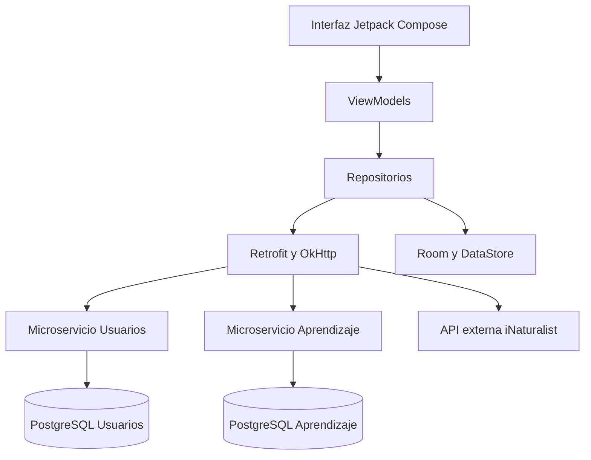

# MPAZ PRO 3.º - Escuela Escritora Marcela Paz

Proyecto de Desarrollo de Aplicaciones Móviles (DSY1105).

**Duoc UC - Sede San Bernardo**  
Evaluación Final Transversal (EFT).

## Descripción del proyecto

MPAZ PRO 3.º es una aplicación móvil educativa orientada a estudiantes de tercero básico de la Escuela Escritora Marcela Paz.

Su propósito es apoyar el aprendizaje mediante contenidos didácticos, actividades interactivas, desafíos progresivos, evaluaciones y seguimiento del rendimiento académico.

La aplicación permite la participación de estudiantes, docentes y jefatura UTP, con funcionalidades diferenciadas según el perfil de acceso.

El proyecto corresponde a un MVP académico y utiliza exclusivamente usuarios y datos ficticios.

## Integrantes

- Martín Faúndez.
- Joaquín Orellana.
- Vicente Vega.

## Objetivos del proyecto

- Apoyar el aprendizaje de estudiantes de tercero básico.
- Organizar contenidos mediante objetivos de aprendizaje (OA).
- Facilitar el seguimiento del rendimiento estudiantil.
- Incorporar actividades y evaluaciones interactivas.
- Permitir la revisión pedagógica de contenidos por UTP.
- Integrar microservicios y servicios externos mediante Internet.
- Aplicar buenas prácticas de desarrollo, seguridad y pruebas.

## Asignaturas

- Lenguaje.
- Matemática.
- Ciencias Naturales.
- Historia.

El alcance académico considera una unidad por asignatura.

## Perfiles y funcionalidades

### Estudiante

- Inicio de sesión mediante RUT y contraseña.
- Consulta de objetivos de aprendizaje asignados.
- Visualización de contenidos aprobados.
- Lectura de explicaciones, ejemplos e imágenes de apoyo.
- Reproducción de contenidos mediante texto a voz.
- Resolución de desafíos de dificultad progresiva.
- Retroalimentación inmediata.
- Realización de evaluaciones finales.
- Consulta de respuestas correctas e incorrectas.
- Visualización de su propio progreso.
- Acceso al minijuego Exploradores de Chile.

### Docente

- Asignación de objetivos de aprendizaje.
- Creación de contenidos educativos.
- Incorporación de imágenes mediante cámara o galería.
- Creación de preguntas para desafíos y evaluaciones.
- Configuración de intentos de evaluación.
- Consulta de resultados estudiantiles.
- Generación de informes pedagógicos.
- Validación y uso compartido de informes.

### Jefatura UTP

- Revisión de contenidos educativos.
- Verificación de objetivos de aprendizaje.
- Aprobación de contenidos.
- Rechazo de contenidos con observaciones.
- Supervisión pedagógica del material educativo.

Solo los contenidos aprobados pueden ser visualizados por los estudiantes.

## Tecnologías utilizadas

| Tecnología | Propósito |
|---|---|
| Kotlin | Lenguaje de programación |
| Jetpack Compose | Interfaz de usuario |
| Material 3 | Diseño visual |
| MVVM | Arquitectura de la aplicación |
| Navigation Compose | Navegación |
| Room | Persistencia local |
| DataStore | Preferencias locales |
| Coroutines | Operaciones asíncronas |
| StateFlow | Gestión de estados |
| Retrofit | Consumo de servicios REST |
| OkHttp | Comunicación HTTP y HTTPS |
| Spring Boot | Microservicios backend |
| PostgreSQL | Persistencia en la nube |
| Render | Despliegue de microservicios |
| Neon | Alojamiento de bases de datos |
| Docker | Contenedores del backend |
| JWT | Autenticación |
| JUnit | Pruebas automatizadas |
| JaCoCo | Medición de cobertura |
| Git y GitHub | Control de versiones |
| Trello | Organización del proyecto |

## Arquitectura

La aplicación utiliza la arquitectura MVVM, separando la interfaz de usuario, la lógica de presentación y el acceso a datos.



Los microservicios se encuentran desplegados en Render y utilizan bases de datos PostgreSQL independientes alojadas en Neon.

La aplicación mantiene componentes de persistencia local para las funcionalidades que los requieren.

## Microservicios

### Usuarios

Responsable de:

- Autenticación de usuarios.
- Validación de credenciales.
- Generación de tokens JWT.
- Gestión de perfiles y permisos.
- Protección de contraseñas mediante BCrypt.

URL:

https://mpaz-usuarios-service.onrender.com/

### Aprendizaje

Responsable de:

- Objetivos de aprendizaje.
- Contenidos educativos.
- Preguntas y evaluaciones.
- Aprobación de contenidos por UTP.
- Registro de respuestas.
- Control de intentos.
- Resultados e informes pedagógicos.

URL:

https://mpaz-aprendizaje-service.onrender.com/

Repositorio del backend:

https://github.com/mwrtinn/MpazPro-microservicios

## API externa - iNaturalist

La aplicación integra la API pública de iNaturalist como recurso educativo relacionado con la biodiversidad.

Esta integración complementa el aprendizaje de Ciencias Naturales mediante el minijuego Exploradores de Chile.

Permite acercar a los estudiantes al conocimiento de la naturaleza mediante información obtenida desde un servicio externo.

Documentación de la API:

https://api.inaturalist.org/v1/docs/

## Recursos nativos de Android

- Cámara para imágenes de apoyo educativo.
- Galería de imágenes.
- FileProvider para el manejo seguro de archivos.
- Texto a voz.
- Detección del estado de conexión.
- Uso compartido de informes pedagógicos.
- Retroalimentación háptica.

La cámara se utiliza exclusivamente para incorporar imágenes de apoyo didáctico. No está destinada a fotografiar estudiantes.

## Validaciones y experiencia de usuario

- Validación del RUT mediante dígito verificador.
- Validación de formularios.
- Mensajes de error y retroalimentación visual.
- Indicadores de carga.
- Animaciones y transiciones.
- Navegación diferenciada por perfil.
- Manejo de estados de interfaz.
- Control de permisos para recursos nativos.
- Manejo de errores de conexión.

## Estructura del proyecto

```text
app/src/main/java/cl/duoc/mpazpro/
├── data/
├── model/
├── navigation/
├── recursos/
├── repository/
├── ui/
│   ├── components/
│   ├── screen/
│   └── theme/
├── utils/
├── viewmodel/
└── MainActivity.kt
```

Las pruebas se encuentran en:

```text
app/src/test/
app/src/androidTest/
```

## Requisitos de ejecución

- Android Studio.
- JDK compatible con la configuración de Gradle.
- Android SDK.
- Dispositivo Android 9 (API 28) o superior.
- Conexión a Internet para acceder a los servicios remotos.

## Configuración desde el código fuente

Clonar el repositorio:

```bash
git clone https://github.com/mwrtinn/MpazPro.git
```

Abrir el proyecto en Android Studio y sincronizar Gradle.

En el archivo local.properties de la raíz del proyecto, conservar la configuración existente del SDK y agregar:

```properties
MPAZ_URL_USUARIOS=https://mpaz-usuarios-service.onrender.com/
MPAZ_URL_APRENDIZAJE=https://mpaz-aprendizaje-service.onrender.com/
MPAZ_RELEASE_HTTP_LOCAL=false
```

El archivo local.properties no se incorpora al repositorio.

Seleccionar un emulador o dispositivo físico y ejecutar la aplicación.

No es necesario iniciar los microservicios locales cuando se utilizan las direcciones de la nube.

## Instalación mediante APK

La aplicación dispone de un APK de tipo release firmado digitalmente.

Para instalarlo:

1. Obtener el APK entregado por el desarrollador.
2. Transferirlo al dispositivo Android.
3. Abrir el archivo.
4. Autorizar la instalación desde la fuente correspondiente si Android lo solicita.
5. Completar la instalación.
6. Abrir MPAZ PRO e iniciar sesión.

La instalación fue probada satisfactoriamente en un Xiaomi 11T con Android 14.

La disponibilidad de instalación en otros dispositivos puede depender de las políticas de seguridad y verificación de Android.

## Usuarios ficticios de demostración

| Perfil | RUT |
|---|---|
| Docente | 12.345.678-5 |
| Jefatura UTP | 13.456.789-9 |
| Estudiante 1 | 11.111.111-1 |
| Estudiante 2 | 22.222.222-2 |

Las contraseñas correspondientes al entorno de la nube se entregan de manera privada al evaluador.

No se publican credenciales de acceso en GitHub.

## Pruebas automatizadas

| Componente | Pruebas aprobadas |
|---|---:|
| Aplicación Android | 147 |
| Microservicio Usuarios | 12 |
| Microservicio Aprendizaje | 14 |
| Total | 173 |

Las pruebas abarcan funcionalidades relacionadas con validaciones, autenticación, lógica de aprendizaje, evaluación, informes y gestión de estados.

### Cobertura de la lógica Android

Resultados obtenidos mediante JaCoCo:

| Métrica | Cobertura |
|---|---:|
| Instrucciones | 81,76 % |
| Líneas | 82,84 % |
| Ramas | 69 % |

La cobertura corresponde al conjunto de clases de lógica seleccionado para las pruebas y no representa la totalidad de la interfaz gráfica ni de la aplicación.

### Ejecutar las pruebas en Windows

```powershell
.\gradlew.bat testDebugUnitTest
```

### Compilar la versión release

```powershell
.\gradlew.bat assembleRelease
```

La generación del APK firmado requiere configurar la llave privada de firma correspondiente.

## Firma digital y registro Android

- Nombre de la aplicación: MPAZ PRO 3.º.
- Application ID: cl.mwrtinn.mpazpro.
- Namespace: cl.duoc.mpazpro.
- Tipo de compilación: release.
- Firma mediante certificado digital.
- Cuenta Android Developer de distribución limitada.
- Nombre de paquete registrado.
- Certificado de firma verificado mediante SHA-256.

El APK se instala correctamente en el dispositivo de prueba.

La autorización individual del Xiaomi mediante Android Developer Console permanece pendiente debido a un error de detección del dispositivo en el portal de Google.

El registro del paquete no equivale a una publicación en Google Play Store ni garantiza distribución ilimitada.

## Seguridad

- Autenticación mediante JWT.
- Autorización según el rol del usuario.
- Contraseñas protegidas mediante BCrypt en el backend.
- Comunicación HTTPS con los microservicios remotos.
- Validación de formularios y datos.
- Restricción de acceso a resultados estudiantiles.
- Protección de configuraciones y archivos privados mediante .gitignore.
- Separación de las credenciales respecto del código fuente.

La llave privada de firma y sus contraseñas no se almacenan en GitHub.

## Flujo sugerido de demostración

1. Iniciar sesión como docente.
2. Crear un contenido educativo.
3. Adjuntar una imagen de apoyo.
4. Iniciar sesión como UTP.
5. Aprobar el contenido.
6. Iniciar sesión como estudiante.
7. Consultar el contenido aprobado.
8. Resolver desafíos y evaluaciones.
9. Probar el minijuego Exploradores de Chile.
10. Iniciar sesión como docente.
11. Consultar resultados.
12. Generar, validar y compartir un informe pedagógico.

## Control de versiones

Repositorio:

https://github.com/mwrtinn/MpazPro

Ramas principales del desarrollo:

- master: versión principal integrada.
- feature/integracion-retrofit: integración de microservicios y funcionalidades finales.

Se utilizan commits descriptivos para conservar la trazabilidad del desarrollo.

La planificación se organiza mediante Trello.

## Estado del proyecto

- [x] Interfaz de usuario.
- [x] Arquitectura MVVM.
- [x] Persistencia local.
- [x] Recursos nativos.
- [x] Microservicios propios.
- [x] Integración mediante Retrofit.
- [x] Despliegue en la nube.
- [x] Persistencia PostgreSQL.
- [x] API externa.
- [x] Minijuego educativo.
- [x] Pruebas automatizadas.
- [x] Cobertura de instrucciones de lógica superior al 80 %.
- [x] APK firmado.
- [x] Registro de paquete Android.
- [x] Certificado de firma verificado.
- [x] Instalación en dispositivo físico.
- [ ] Autorización individual del dispositivo en Android Developer Console.

## Limitaciones y consideraciones

El proyecto utiliza servicios de alojamiento gratuitos.

Los microservicios pueden experimentar demoras iniciales cuando permanecen inactivos.

Las cuotas y condiciones de los proveedores pueden cambiar.

Las funcionalidades remotas requieren conexión a Internet.

El sistema corresponde a un prototipo académico y requiere evaluaciones adicionales antes de utilizarse en un entorno educativo real.

Los objetivos de aprendizaje y contenidos deben contrastarse con el Currículum Nacional del Ministerio de Educación de Chile.

Los informes pedagógicos describen el rendimiento registrado. No constituyen diagnósticos profesionales ni generan decisiones académicas automáticas.

## Finalidad académica

Proyecto desarrollado para la asignatura Desarrollo de Aplicaciones Móviles de Duoc UC.

Todos los usuarios, respuestas, evaluaciones y resultados utilizados en la demostración son ficticios.
